<picture>
  <source media="(prefers-color-scheme: dark)" srcset="https://raw.githubusercontent.com/rohansh2017/rohansh2017/output/pacman-contribution-graph-dark.svg">
  <source media="(prefers-color-scheme: light)" srcset="https://raw.githubusercontent.com/rohansh2017/rohansh2017/output/pacman-contribution-graph.svg">
  
</picture>

<h1 align="center">Rohan Sharma</h1>

<b>I study how people think, and I build software that thinks a little.</b> 
CS + Cognitive Science @ Rutgers · graduating May 2027

  
  
  

---

### Right now

| | |
|---|---|
| 🏆 **Just won** | Best Use of Code & Technology and Best Use of Gemini at NASA Space Apps NYC 2026 |
| 🔬 **Researching** | Fine-tuning a language model on Mathematica syntax, with a paper in progress |
| 🧑‍🏫 **Running** | Road to SWE, a mentorship program I started for Rutgers CS freshmen |
| 💼 **Last summer** | Software engineering intern at Clear Street, where I cut Datadog log volume 66% |
| 🎯 **Next** | New-grad Software Engineer or AI/ML Engineer roles in NYC, starting summer 2027 |

### Things I've built

<table>
  <tr>
    <td width="45%">
      
    </td>
    <td>
      <h4>🌒 <a href="https://github.com/rohansh2017/Space-Apps-2026">Tranquility Base</a> · <a href="https://tranquility-base.rohansh2017.workers.dev">try it</a></h4>
      Stand on real lunar terrain in 3D and find new landing sites and dates when a launch slips. It ranks 5,000 points across 60 days in under a second.  
      <b>Won two awards at NASA Space Apps NYC 2026.</b> Team of four.  
      <code>TypeScript</code> <code>React</code> <code>three.js</code> <code>Python</code> <code>Gemini</code> <code>Cloudflare Workers</code>
    </td>
  </tr>
</table>

#### 🤖 [PR Review Agent](https://github.com/rohansh2017/pr-review-agent) 

A webhook service that reads pull request diffs with Claude and posts inline comments on bugs, security issues and missing tests.

`Python` `FastAPI` `LangChain` `Claude API` `Fly.io`

### Toolbox

| Languages | AI / ML | Web and backend | Infrastructure |
|:---:|:---:|:---:|:---:|
|  |  |  |  |

Also: LangChain, the Claude and Gemini APIs, Terraform.

The game at the top is my contribution graph. It regenerates every 12 hours.
